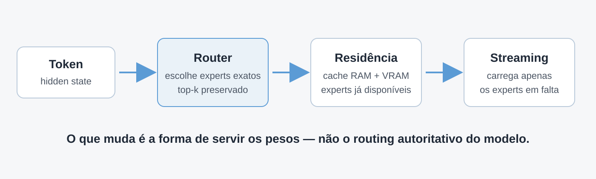
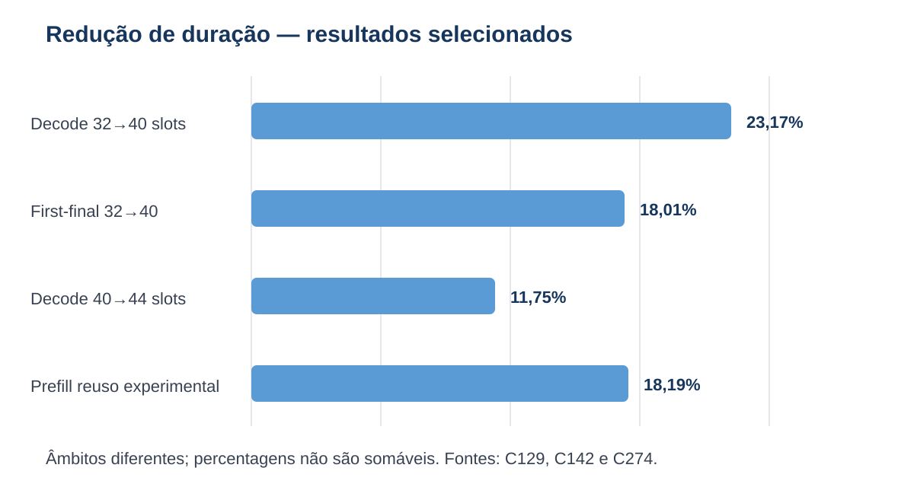

# Apresentação — outline

## Slide 1 — Tesy

**Inferência local de LLMs MoE sob restrições severas de memória**

Primeira reunião de orientação. Mostrar apenas o target e a ideia central.

## Slide 2 — O problema

- capacidade: modelo ≫ VRAM;
- movimentação: experts têm de atravessar tiers de memória;
- latência útil: prefill e decode têm gargalos diferentes.

Pergunta central: quanto da capacidade de um MoE enorme pode ser tornado utilizável localmente sem aproximar o routing?

## Slide 3 — A ideia

Routing/top-k/pesos continuam autoritativos. O sistema muda apenas a forma de servir os experts.

## Slide 4 — Resultados já obtidos

Dizer explicitamente que são âmbitos diferentes e que as percentagens não são somáveis.

## Slide 5 — Entraves já demonstrados

- overlap mínimo: margem insuficiente;
- EAGLE3: head real mais lento no desenho testado;
- prefetch aprendido: previsão melhor, latência pior;
- compressão lossless: redução de bytes insuficiente para justificar integração.

## Slide 6 — Enquadramento da tese

Estudo de sistemas sobre inferência MoE exata e out-of-core em hardware de consumo: medição, arquitetura, exactness e limites.

Estado: `ENGINEERING_AND_MEASUREMENT_GO`, sem claim de novidade ampla.

## Slide 7 — Contexto científico

Quatro referências: Shazeer et al.; Fedus et al.; HOBBIT; fMoE. Não fazer revisão bibliográfica completa nesta reunião.

## Slide 8 — Discussão com a orientadora

1. pergunta suficientemente delimitada?
2. baselines e critérios de qualidade?
3. núcleo em execução out-of-core exata para MoE?
4. que resultados já feitos entram na tese e quais ficam como exploração?
